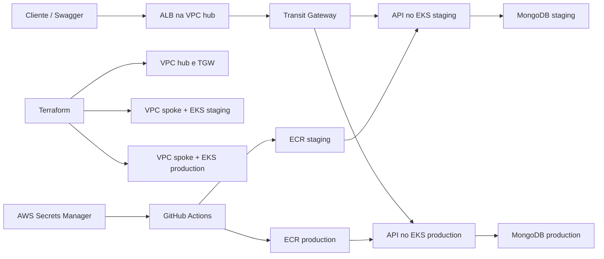

# PedeLogo Catálogo

[](https://dotnet.microsoft.com/)
[](https://aws.amazon.com/eks/)
[](https://www.terraform.io/)
[](https://www.mongodb.com/)
[](https://aws.amazon.com/ecr/)
[](https://opentelemetry.io/)
[](https://prometheus.io/)
[](https://grafana.com/)

Projeto de referência para desenvolvimento e operação de uma API de catálogo de produtos com **.NET 8**, **MongoDB** e **Kubernetes na AWS (Amazon EKS)**. O repositório reúne a aplicação, infraestrutura como código, manifests Kubernetes, automação CI/CD e configuração de observabilidade.

> **Estado do projeto:** projeto de estudo e referência técnica. 

## Índice

- [Visão geral](#visão-geral)
- [Arquitetura](#arquitetura)
- [Tecnologias](#tecnologias)
- [Estrutura do repositório](#estrutura-do-repositório)
- [Executar localmente](#executar-localmente)
- [Testes](#testes)
- [Infraestrutura AWS com Terraform](#infraestrutura-aws-com-terraform)
- [Aplicação no Kubernetes](#aplicação-no-kubernetes)
- [Observabilidade](#observabilidade)
- [CI/CD](#cicd)
- [Segurança e operação](#segurança-e-operação)
- [Documentação relacionada](#documentação-relacionada)

## Visão geral

A API permite consultar, cadastrar, atualizar e remover produtos armazenados no MongoDB. O serviço é empacotado em uma imagem Docker e implantado no EKS. A infraestrutura AWS é descrita em Terraform, e os workflows do GitHub Actions automatizam verificações, build, publicação de imagem e implantação.

### Funcionalidades da API

| Método | Rota | Descrição |
|---|---|---|
| `GET` | `/Produto` | Lista os produtos |
| `GET` | `/Produto/{id}` | Consulta produto pelo identificador MongoDB |
| `POST` | `/Produto` | Cadastra um produto |
| `PUT` | `/Produto/{id}` | Atualiza um produto |
| `DELETE` | `/Produto?id={id}` | Remove produto pelo parâmetro `id` |
| `GET` | `/health` | Health check da aplicação |
| `GET` | `/read` | Readiness check usado pelo Kubernetes |
| `GET` | `/metrics` | Métricas expostas pelo `prometheus-net` |
| `GET` | `/swagger/index.html` | Interface Swagger/OpenAPI |

Consulte o Swagger do ambiente para ver o contrato publicado pela versão atualmente implantada.

## Arquitetura



### Fluxo de métricas

```text
API .NET 8
  -> instrumentação automática OpenTelemetry
  -> OTLP HTTP :4318
  -> OpenTelemetry Collector
  -> exporter Prometheus :8889
  -> ServiceMonitor
  -> Prometheus
  -> dashboard Grafana
```

## Tecnologias

| Área | Componentes usados |
|---|---|
| Aplicação | .NET 8, ASP.NET Core, MongoDB.Driver, `prometheus-net.AspNetCore` |
| Banco de dados | MongoDB 4.4.0 |
| Containers | Docker; imagem da API publicada no Amazon ECR |
| Orquestração | Kubernetes no Amazon EKS; Deployments, StatefulSets, Services, HPAs, RBAC e NetworkPolicies |
| Infraestrutura | Terraform >= 1.7; AWS Provider `~> 6.67`; módulo EKS `21.30.2`; módulos de VPC e rede locais |
| Observabilidade | OpenTelemetry Operator e Collector Contrib 0.160.0, Prometheus, Grafana e `kube-prometheus-stack` chart 92.3.0 |
| CI/CD e qualidade | GitHub Actions, xUnit, SonarCloud, Trivy, Checkov |

As versões declaradas podem evoluir. Consulte os manifests, arquivos de projeto e workflows para a configuração efetivamente aplicada.

## Estrutura do repositório

```text
.
├── .github/
│   └── workflows/       # CI/CD da aplicação, Terraform e teste do cluster
├── infra/               # Terraform da VPC e do EKS; variáveis por ambiente
├── k8s/
│   ├── cadastro-k8s/    # API: Deployment, Service, HPA, RBAC e configuração
│   ├── mongodb-k8s/     # MongoDB: StatefulSet, Service, HPA e RBAC
│   └── README.md        # Guia de workloads Kubernetes
├── observability/       # OpenTelemetry, Prometheus, Grafana e script de tráfego
│   └── README.md        # Guia de implantação e diagnóstico da observabilidade
├── src/
│   ├── PedeLogo.Catalogo.Api/
│   ├── PedeLogo.Catalogo.sln
│   └── tests/
│       ├── PedeLogo.Catalogo.UnitTests/
│       └── PedeLogo.Catalogo.IntegrationTests/
├── testeEks/            # Manifest usado no teste de comunicação de pods
└── readme.md
```

## Executar localmente

### Pré-requisitos

- .NET SDK 8.x
- Docker, para executar MongoDB localmente
- Git

### 1. Iniciar o MongoDB local

Os valores abaixo são apenas para desenvolvimento local e correspondem aos defaults do `appsettings.json`. Não reutilize essas credenciais em ambientes compartilhados ou produção.

```bash
docker run --detach \
  --name catalogo-mongodb \
  --publish 27017:27017 \
  --env MONGO_INITDB_ROOT_USERNAME=mongouser \
  --env MONGO_INITDB_ROOT_PASSWORD=mongopwd \
  mongo:4.4.0
```

### 2. Restaurar dependências e iniciar a API

```bash
dotnet restore src/PedeLogo.Catalogo.sln
dotnet run --project src/PedeLogo.Catalogo.Api/PedeLogo.Catalogo.Api.csproj
```

O perfil do projeto declara `http://localhost:5000` e `https://localhost:5001`. Abra o Swagger em <http://localhost:5000/swagger/index.html>.

Para encerrar e remover o container local do banco:

```bash
docker stop catalogo-mongodb
docker rm catalogo-mongodb
```

## Testes

Executar os projetos de teste individualmente:

```bash
dotnet test src/tests/PedeLogo.Catalogo.UnitTests/PedeLogo.Catalogo.UnitTests.csproj
dotnet test src/tests/PedeLogo.Catalogo.IntegrationTests/PedeLogo.Catalogo.IntegrationTests.csproj
```

Os testes de integração dependem de uma instância MongoDB disponível. A pipeline de integração configura MongoDB 4.4.0 como serviço e fornece as credenciais por GitHub Secrets.

Executar todos os testes da solução:

```bash
dotnet test src/PedeLogo.Catalogo.sln
```

## Infraestrutura AWS com Terraform

O código em [`infra/`](./infra/) cria as VPCs, os recursos de rede e os clusters EKS com Terraform.

### Topologia e isolamento

Há uma VPC hub compartilhada e uma VPC spoke independente para cada ambiente. O hub contém o Transit Gateway, o NAT Gateway e o ALB; cada state de ambiente controla somente sua VPC spoke, o attachment/rotas próprios, o cluster EKS e o ECR daquele ambiente. As spokes usam o hub para tráfego com a Internet e com o ALB; as rotas `blackhole` impedem comunicação direta entre staging e production. A configuração `cluster_names` e os CIDRs em `peer_vpc_cidrs` no tfvars do hub devem corresponder aos tfvars dos dois ambientes.

| Stack | VPC | Subnets | Recursos |
|---|---|---|---|
| Hub | `10.0.0.0/16` | Públicas `10.0.1.0/24`, `10.0.2.0/24`; trânsito `10.0.11.0/24`, `10.0.12.0/24` | IGW, NAT, ALB, Transit Gateway |
| Staging | `10.1.0.0/16` | Privadas `10.1.11.0/24`, `10.1.12.0/24` | TGW attachment, EKS, ECR staging |
| Production | `10.2.0.0/16` | Privadas `10.2.11.0/24`, `10.2.12.0/24` | TGW attachment, EKS, ECR production |

O ALB do hub tem listener HTTP na porta **80 para staging** e **8080 para production**, ambos com target groups IP próprios. O NAT do hub é compartilhado e está em uma única AZ; não há NAT redundante por AZ.

O mesmo root e provider Terraform usam três arquivos de variáveis:

- [`infra/environments/hub/terraform.tfvars.example`](./infra/environments/hub/terraform.tfvars.example)
- [`infra/environments/staging/terraform.tfvars.example`](./infra/environments/staging/terraform.tfvars.example)
- [`infra/environments/production/terraform.tfvars.example`](./infra/environments/production/terraform.tfvars.example)

Os arquivos reais `terraform.tfvars` ficam ignorados pelo Git. As três chaves no mesmo bucket são `infra/hub/terraform.tfstate`, `infra/staging/terraform.tfstate` e `infra/production/terraform.tfstate`. Staging e production leem somente os outputs do state hub; nenhum ambiente lê o state do outro.

> **Atenção:** os endpoints públicos do EKS estão habilitados. Restrinja `endpoint_public_access_cidrs` aos IPs administrativos ou desabilite o acesso público quando possível. Consulte [a documentação da AWS sobre endpoints do EKS](https://docs.aws.amazon.com/eks/latest/userguide/cluster-endpoint.html).

### States, planos e promoção

Inicialize e aplique o state hub uma vez antes de usar os states de ambiente; staging e production precisam ler seus outputs para anexar ao TGW. O hub é a rede compartilhada e tem ciclo de manutenção próprio; o workflow de promoção abaixo não aplica mudanças nele.

Em um PR para `main`, o workflow executa Terraform validate, TFLint, Checkov, Infracost e planos somente de leitura para staging e production. Após o merge, a mesma execução e o mesmo SHA seguem esta ordem:

```text
Plan staging → Apply do plan staging → infra_test_cluster.yaml (smoke tests)
  → Plan production → aprovação do GitHub Environment production
  → Apply do plan production salvo
```

O plano de production é criado **depois** dos testes de staging e é aplicado como artefato salvo após a aprovação. Ele é gerado para o state e as variáveis de production do mesmo commit; o binário do plano de staging não pode ser reaplicado contra outro state.

Configure revisores obrigatórios em **Settings → Environments → production** para habilitar a aprovação manual. O bucket S3 permanece o mesmo; cada stack usa sua própria chave de backend. A role OIDC `AWS_ROLE` precisa ler o state hub, ler/atualizar os states staging e production e administrar os recursos AWS.

Para executar localmente, use o arquivo do ambiente explicitamente e inicialize o backend com a chave correspondente:

```bash
cd infra
export TF_VAR_state_bucket="<bucket>"
terraform init -reconfigure \
  -backend-config="bucket=<bucket>" \
  -backend-config="key=infra/hub/terraform.tfstate" \
  -backend-config="region=us-east-1"
terraform plan -var-file=environments/hub/terraform.tfvars
terraform apply -var-file=environments/hub/terraform.tfvars
```

Após o apply do hub, inicialize staging e production com suas chaves e arquivos `terraform.tfvars` correspondentes; exporte `TF_VAR_state_bucket=<bucket>` antes do plan para ler os outputs do hub. Para destruir o laboratório, remova primeiro staging e production (attachments e rotas) e, por último, o hub. O state legado não é migrado automaticamente; não o apague enquanto ainda controlar recursos ativos.

### ECR e segredos externos

O Terraform cria repositórios ECR separados (`catalogo-api-staging` e `catalogo-api-production`), com tags imutáveis, scan ao publicar e retenção das 30 imagens tagueadas mais recentes. O CI publica a imagem do mesmo SHA nos dois repositórios.

Os segredos `projeto-cadastro/staging/mongodb` e `projeto-cadastro/production/mongodb` permanecem no AWS Secrets Manager e são externos ao Terraform. O CD lê o segredo do ambiente e cria/atualiza o `mongodb-secret` no cluster; não grave credenciais nos arquivos de variáveis. A role OIDC do CD precisa de `secretsmanager:GetSecretValue` nos dois segredos e `secretsmanager:ListSecrets` em `Resource: "*"`. Com uma chave KMS gerenciada pelo cliente, conceda também `kms:Decrypt`.

A role dos workflows precisa de `ecr:GetAuthorizationToken` em `Resource: "*"`, permissões de push nos dois repositórios e permissões de pull para os nós EKS. A role Terraform precisa administrar VPC/TGW, rotas, EKS, ECR e tags; ajuste as permissões e ARNs à conta e região do laboratório.

Configure no GitHub Actions os secrets `AWS_ROLE`, `BUCKET`, `TF_VARS_STAGING`, `TF_VARS_PRODUCTION` e `INFRACOST_API_KEY`. As variáveis usadas incluem `REGION`, `TF_VERSION`, `eks_stg` e `eks_prod`. Os segredos MongoDB e as credenciais de testes da aplicação continuam separados.

Os comandos locais de validação, dentro de `infra/`, são:

```bash
terraform init -backend=false
terraform fmt -check -recursive
terraform validate
```

## Aplicação no Kubernetes

A API e o MongoDB são implantados no namespace `default`. A API usa um Service `ClusterIP` na porta 80 e é exposta pelo ALB compartilhado no hub através do TGW: staging usa a porta 80 e production a porta 8080. O MongoDB é acessível internamente por um Service headless na porta 27017.

O manifesto da API contém placeholders de registry e tag; a pipeline seleciona o repositório ECR do ambiente e injeta a imagem publicada. O EKS Auto Mode permite que os nós baixem essa imagem sem `imagePullSecret`. O MongoDB usa StatefulSet, probes de saúde, recursos requests/limits e políticas de rede. As credenciais são obtidas do Secrets Manager e materializadas como `mongodb-secret` durante o CD.

Guia de pré-requisitos, implantação, configuração, autoscaling e diagnóstico: [`k8s/README.md`](./k8s/README.md).

## Observabilidade

A configuração em [`observability/`](./observability/) instrumenta a API com OpenTelemetry, exporta métricas para Prometheus e disponibiliza um dashboard Grafana. O dashboard apresenta taxa de requisições, latência, respostas 5xx e métricas por rota.

Guia completo de implantação do stack, instrumentação, acesso por port-forward, geração de tráfego e troubleshooting: [`observability/README.md`](./observability/README.md).

## CI/CD

Os workflows ficam em `.github/workflows/`. O comportamento abaixo resume os gatilhos definidos nos arquivos atuais:

| Fluxo | Gatilho/escopo | Etapas principais |
|---|---|---|
| Testes da aplicação (`App_testeEstatico.yaml`) | Push para `feature/**`, `hotfix/**` ou `main`, e PR para `main`; alterações em `src/**` | Testes unitários, integração com MongoDB, cobertura e análise SonarCloud |
| Build de imagem (`App_CI.yaml`) | Reutilizável; chamado pelo workflow de testes em PR após os jobs de qualidade | OIDC na AWS, buildx, scan Trivy para vulnerabilidades CRITICAL e push ao ECR com tag única SHA/tentativa |
| CD da aplicação (`App_CD.yaml`, `App_CD_prod.yaml`) | Workflows reutilizáveis chamados pelo fluxo da aplicação | Login no ECR, leitura do segredo específico do ambiente e deploy no EKS; usa GitHub Environments `staging` e `production` |
| Infraestrutura (`infra_CI.yaml`, `infra_CD.yaml`) | PR e push para `main`; alterações em `infra/**` ou no workflow de infra | PR valida, roda TFLint, Checkov, Infracost e planos sem apply; merge promove staging, roda `infra_test_cluster.yaml`, gera o plan production e aguarda aprovação antes de aplicar o artefato salvo |

> Revise os gatilhos dos workflows e as proteções dos GitHub Environments antes de adotar a pipeline em produção. A aprovação manual depende da configuração dos environments no GitHub; ela não é garantida apenas pelo nome do ambiente no YAML.

### Configuração necessária no GitHub

Os workflows dependem de configurações em **Settings → Secrets and variables → Actions** e de environments `staging` e `production`. Entre os nomes referenciados pelos workflows estão:

- Secrets: `AWS_ROLE`, `BUCKET`, `TF_VARS_STAGING`, `TF_VARS_PRODUCTION`, `INFRACOST_API_KEY`, `mongo_user`, `mongo_pwd`, `SONAR_PROJECT_KEY`, `SONAR_ORGANIZATION`, `SONAR_TOKEN`. `mongo_user`/`mongo_pwd` continuam sendo usados pelos testes de integração; credenciais dos clusters ficam no Secrets Manager.
- Variables: `REGION`, `TF_VERSION`, `eks_stg`, `eks_prod`, `CLUSTER_NAME`.

Configure as credenciais AWS via OIDC conforme os workflows e limite permissões às funções necessárias. Os valores reais devem ser definidos no GitHub, nunca copiados para documentação ou commits.

## Segurança e operação

- O payload dos segredos do cluster não é armazenado nos manifests nem no Terraform state. Credenciais anteriormente versionadas devem ser rotacionadas; removê-las dos arquivos atuais não as remove do histórico Git.
- O Secret Kubernetes criado pelo workflow continua armazenado no cluster. Restrinja RBAC e acesso ao cluster, habilite criptografia de Secrets em repouso e planeje rotação das credenciais.
- O ALB do laboratório usa HTTP nas portas 80 e 8080, sem TLS. Antes de produção, configure certificado HTTPS e revise autenticação/autorização da API, NetworkPolicies e regras de Security Groups.
- O `kube-prometheus-stack` está configurado com retenção Prometheus de 1 dia e armazenamento efêmero (`emptyDir`); métricas podem ser perdidas quando o pod reinicia.
- Configure backup e persistência apropriados para dados MongoDB antes de uso produtivo.
- Proteja o acesso aos dashboards e ao endpoint Prometheus. O port-forward é recomendado para acesso local de operação.

## Documentação relacionada

- [Kubernetes: arquitetura, deploy e troubleshooting](./k8s/README.md)
- [Observabilidade: OpenTelemetry, Prometheus e Grafana](./observability/README.md)
- [Workflows de CI/CD](./.github/workflows/)
- [Infraestrutura Terraform](./infra/)

## Autor

**Patrick Amorim** — [@patrickpk4](https://github.com/patrickpk4)

Projeto de estudo e referência técnica para desenvolvimento, infraestrutura e operação cloud-native.
