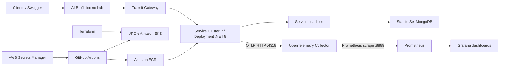
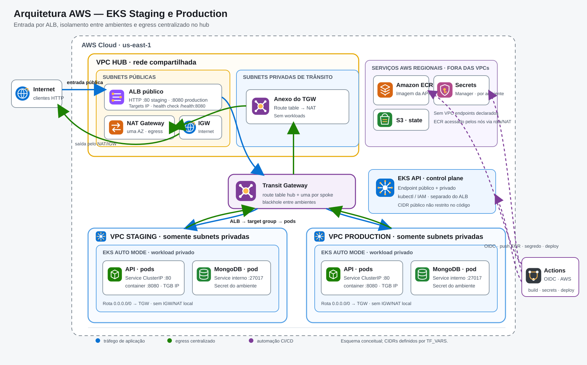

# PedeLogo Catálogo

[](https://dotnet.microsoft.com/)
[](https://aws.amazon.com/eks/)
[](https://www.terraform.io/)
[](https://www.mongodb.com/)
[](https://aws.amazon.com/ecr/)
[](https://opentelemetry.io/)
[](https://prometheus.io/)
[](https://grafana.com/)

Projeto de referência para desenvolvimento e operação de uma API de catálogo de produtos com **.NET 8**, **MongoDB** e **Kubernetes na AWS (Amazon EKS)**. O repositório reúne a aplicação, infraestrutura como código, manifests Kubernetes, automação CI/CD e configuração de observabilidade.

> **Estado do projeto:** projeto de estudo e referência técnica. 

## Índice

- [Visão geral](#visão-geral)
- [Arquitetura](#arquitetura)
- [Tecnologias](#tecnologias)
- [Estrutura do repositório](#estrutura-do-repositório)
- [Executar localmente](#executar-localmente)
- [Testes](#testes)
- [Infraestrutura AWS com Terraform](#infraestrutura-aws-com-terraform)
- [Aplicação no Kubernetes](#aplicação-no-kubernetes)
- [Observabilidade](#observabilidade)
- [CI/CD](#cicd)
- [Segurança e operação](#segurança-e-operação)
- [Documentação relacionada](#documentação-relacionada)

## Visão geral

A API permite consultar, cadastrar, atualizar e remover produtos armazenados no MongoDB. O serviço é empacotado em uma imagem Docker e implantado no EKS. A infraestrutura AWS é descrita em Terraform, e os workflows do GitHub Actions automatizam verificações, build, publicação de imagem e implantação.

### Funcionalidades da API

| Método | Rota | Descrição |
|---|---|---|
| `GET` | `/Produto` | Lista os produtos |
| `GET` | `/Produto/{id}` | Consulta produto pelo identificador MongoDB |
| `POST` | `/Produto` | Cadastra um produto |
| `PUT` | `/Produto/{id}` | Atualiza um produto |
| `DELETE` | `/Produto?id={id}` | Remove produto pelo parâmetro `id` |
| `GET` | `/health` | Health check da aplicação |
| `GET` | `/read` | Readiness check usado pelo Kubernetes |
| `GET` | `/metrics` | Métricas expostas pelo `prometheus-net` |
| `GET` | `/swagger/index.html` | Interface Swagger/OpenAPI |

Consulte o Swagger do ambiente para ver o contrato publicado pela versão atualmente implantada.

## Arquitetura



### Fluxo de métricas

```text
API .NET 8
  -> instrumentação automática OpenTelemetry
  -> OTLP HTTP :4318
  -> OpenTelemetry Collector
  -> exporter Prometheus :8889
  -> ServiceMonitor
  -> Prometheus
  -> dashboard Grafana
```

## Tecnologias

| Área | Componentes usados |
|---|---|
| Aplicação | .NET 8, ASP.NET Core, MongoDB.Driver, `prometheus-net.AspNetCore` |
| Banco de dados | MongoDB 4.4.0 |
| Containers | Docker; imagem da API publicada no Amazon ECR |
| Orquestração | Kubernetes no Amazon EKS; Deployments, StatefulSets, Services, HPAs, RBAC e NetworkPolicies |
| Infraestrutura | Terraform >= 1.7; AWS Provider `~> 6.67`; módulo EKS `~> 21.0`; módulos de VPC e rede locais |
| Observabilidade | OpenTelemetry Operator e Collector Contrib 0.160.0, Prometheus, Grafana e `kube-prometheus-stack` chart 92.3.0 |
| CI/CD e qualidade | GitHub Actions, xUnit, SonarCloud, Trivy, Checkov |

As versões declaradas podem evoluir. Consulte os manifests, arquivos de projeto e workflows para a configuração efetivamente aplicada.

## Estrutura do repositório

```text
.
├── .github/
│   └── workflows/       # CI/CD da aplicação, Terraform e teste do cluster
├── infra/               # Terraform da VPC e do EKS; variáveis por ambiente
├── k8s/
│   ├── cadastro-k8s/    # API: Deployment, Service, HPA, RBAC e configuração
│   ├── mongodb-k8s/     # MongoDB: StatefulSet, Service, HPA e RBAC
│   └── README.md        # Guia de workloads Kubernetes
├── observability/       # OpenTelemetry, Prometheus, Grafana e script de tráfego
│   └── README.md        # Guia de implantação e diagnóstico da observabilidade
├── src/
│   ├── PedeLogo.Catalogo.Api/
│   ├── PedeLogo.Catalogo.sln
│   └── tests/
│       ├── PedeLogo.Catalogo.UnitTests/
│       └── PedeLogo.Catalogo.IntegrationTests/
├── testeEks/            # Manifest usado no teste de comunicação de pods
└── readme.md
```

## Executar localmente

### Pré-requisitos

- .NET SDK 8.x
- Docker, para executar MongoDB localmente
- Git

### 1. Iniciar o MongoDB local

Os valores abaixo são apenas para desenvolvimento local e correspondem aos defaults do `appsettings.json`. Não reutilize essas credenciais em ambientes compartilhados ou produção.

```bash
docker run --detach \
  --name catalogo-mongodb \
  --publish 27017:27017 \
  --env MONGO_INITDB_ROOT_USERNAME=mongouser \
  --env MONGO_INITDB_ROOT_PASSWORD=mongopwd \
  mongo:4.4.0
```

### 2. Restaurar dependências e iniciar a API

```bash
dotnet restore src/PedeLogo.Catalogo.sln
dotnet run --project src/PedeLogo.Catalogo.Api/PedeLogo.Catalogo.Api.csproj
```

O perfil do projeto declara `http://localhost:5000` e `https://localhost:5001`. Abra o Swagger em <http://localhost:5000/swagger/index.html>.

Para encerrar e remover o container local do banco:

```bash
docker stop catalogo-mongodb
docker rm catalogo-mongodb
```

## Testes

Executar os projetos de teste individualmente:

```bash
dotnet test src/tests/PedeLogo.Catalogo.UnitTests/PedeLogo.Catalogo.UnitTests.csproj
dotnet test src/tests/PedeLogo.Catalogo.IntegrationTests/PedeLogo.Catalogo.IntegrationTests.csproj
```

Os testes de integração dependem de uma instância MongoDB disponível. A pipeline de integração configura MongoDB 4.4.0 como serviço e fornece as credenciais por GitHub Secrets.

Executar todos os testes da solução:

```bash
dotnet test src/PedeLogo.Catalogo.sln
```

## Infraestrutura AWS com Terraform

O código em [`infra/`](./infra/) cria as VPCs, os recursos de rede e os clusters EKS com Terraform.

### Topologia e fluxos de rede



O diagrama representa os recursos declarados em Terraform e nos manifests Kubernetes. Os CIDRs abaixo são exemplos; o plano e a configuração real vêm de `TF_VARS`.

| VPC | Subnets | Uso |
|---|---|---|
| Hub (`10.0.0.0/16`) | Públicas `10.0.1.0/24`, `10.0.2.0/24` | ALB e NAT Gateway; rota para o Internet Gateway |
| Hub (`10.0.0.0/16`) | Privadas `10.0.11.0/24`, `10.0.12.0/24` | Subnets dedicadas ao attachment do Transit Gateway; sem workloads |
| Staging (`10.1.0.0/16`) | Privadas `10.1.11.0/24`, `10.1.12.0/24` | EKS Auto Mode e pods da API e MongoDB |
| Production (`10.2.0.0/16`) | Privadas `10.2.11.0/24`, `10.2.12.0/24` | EKS Auto Mode e pods da API e MongoDB |

O arquivo [`infra/terraform.tfvars.example`](./infra/terraform.tfvars.example) contém esses valores de referência. Os três CIDRs de VPC são faixas privadas RFC1918, não se sobrepõem, e as subnets de trânsito pertencem ao CIDR do hub.

#### Entrada da aplicação

```text
Cliente → ALB público no hub → TGW → target group IP → pod da API
```

- O ALB tem listeners HTTP: **porta 80 para staging** e **porta 8080 para production**. Ambos usam o DNS do mesmo ALB; sem domínio próprio, o ambiente é selecionado pela porta. Não há TLS configurado.
- Cada listener aponta para seu target group, que usa IPs dos pods e health check HTTP em `/health:8080`. O TargetGroupBinding de cada cluster registra os IPs selecionados pelo Service `api-service`.
- O Service é `ClusterIP` na porta 80 e direciona para a porta 8080 do container. Portanto, o Service não é um load balancer público nem recebe tráfego direto da Internet.
- A aplicação e o MongoDB ficam nas subnets privadas das VPCs spoke. O MongoDB só é exposto internamente pelo Service headless na porta 27017.

**A API do EKS é uma entrada administrativa diferente da aplicação.** O endpoint público e o privado estão habilitados; o código não define uma lista restrita de CIDRs para o público. Assim, o endpoint público fica alcançável pela rede, embora ainda exija autenticação IAM e autorização Kubernetes. Restrinja `endpoint_public_access_cidrs` ao IP administrativo ou desabilite o acesso público se a administração puder ocorrer pela rede privada. Consulte [a documentação da AWS sobre endpoints do EKS](https://docs.aws.amazon.com/eks/latest/userguide/cluster-endpoint.html).

#### Saída centralizada e isolamento

```text
Pod/nó em staging ou production
  → route table da subnet privada (0.0.0.0/0 → TGW)
  → route table TGW da spoke (0.0.0.0/0 → attachment do hub)
  → subnet de trânsito do hub (0.0.0.0/0 → NAT)
  → NAT Gateway na subnet pública
  → Internet Gateway
  → Internet
```

- As VPCs staging e production não têm IGW nem NAT próprios. A tabela de rotas do TGW do hub contém as rotas de retorno para cada spoke.
- Cada tabela TGW de spoke também contém uma rota `blackhole` para a outra VPC; isso impede tráfego direto entre os ambientes mesmo com a rota padrão para o hub.
- Existe **um NAT Gateway**, na primeira subnet pública configurada. Isso centraliza o egress, mas cria um ponto único de falha e pode gerar custo de tráfego entre AZs. O exemplo distribui subnets em duas AZs, mas não cria um NAT por AZ.
- A tabela de rotas força o caminho pelo TGW/NAT; o Security Group não escolhe o próximo salto. Por outro lado, a NetworkPolicy da API limita o egress dos pods a MongoDB e DNS. Essas políticas só são aplicadas se o plugin de rede do EKS suportar NetworkPolicy.

#### Security Groups e NetworkPolicies

| Origem | Regra configurada |
|---|---|
| Internet → SG do ALB | TCP 80 e 8080 de `0.0.0.0/0` |
| SG do ALB → VPCs dos clusters | Egress TCP 8080 para os CIDRs das VPCs spoke |
| SG primário do cluster EKS | Ingress TCP 8080 com origem no SG do ALB, usando referência de SG pelo TGW |
| Egress padrão do cluster | O SG gerenciado pelo EKS permite egress; as route tables ainda direcionam o tráfego das spokes pelo TGW |
| Pods da API | NetworkPolicy restringe entrada ao CIDR das subnets públicas do hub e saída a MongoDB/DNS |
| Pod MongoDB | NetworkPolicy permite comunicação interna com a API na porta 27017 |

O Security Group controla o tráfego nas interfaces de rede; as NetworkPolicies controlam tráfego entre pods. O MongoDB é um pod, não uma instância com Security Group próprio. Também não há PVC no StatefulSet atual, então o armazenamento do MongoDB não deve ser considerado persistente.

#### Recursos de apoio

- **ECR:** repositório privado da imagem `catalogo-api`, consumida pelos clusters.
- **Secrets Manager:** segredos separados de staging e production; o CD lê o segredo do ambiente e cria o `mongodb-secret` no cluster.
- **S3:** backend remoto do estado Terraform, configurado pelos workflows.
- **GitHub Actions:** autentica na AWS por OIDC para publicar imagem, ler segredos e executar o deploy. O EKS Auto Mode cuida do provisionamento de nós; não há quantidade fixa de nós definida nesse módulo.

> **Atenção:** se alterar os CIDRs das subnets públicas do hub, atualize as regras da [NetworkPolicy da API](./k8s/cadastro-k8s/networkpolicy-cadastro.yaml) para manter o tráfego do ALB permitido.

### Variáveis e pipeline

`transit_subnets_cidr` é obrigatório em **cada** entrada de `vpcs`: use CIDRs livres dentro da VPC hub e listas vazias nas VPCs spoke. O exemplo completo também inclui os campos obrigatórios de EKS. Ajuste os CIDRs à sua rede real, sem sobreposição:

```hcl
hub        = { cidr_block = "10.0.0.0/16", transit_subnets_cidr = ["10.0.11.0/24", "10.0.12.0/24"] }
staging    = { cidr_block = "10.1.0.0/16", transit_subnets_cidr = [] }
production = { cidr_block = "10.2.0.0/16", transit_subnets_cidr = [] }
```

A pipeline grava o secret `TF_VARS` em `terraform.tfvars`; mantenha nele a mesma estrutura e os mesmos CIDRs coerentes com as NetworkPolicies.

A role AWS informada por `AWS_ROLE` precisa de permissões para criar e administrar Transit Gateways, anexos, rotas, route tables, subnets e tags. A pipeline de staging também consulta o ALB (`elasticloadbalancing:DescribeLoadBalancers`). Por exemplo, a criação do gateway exige `ec2:CreateTransitGateway`. Um erro `UnauthorizedOperation` deve ser corrigido na policy IAM dessa role.

Os outputs `staging_url` e `production_url` informam os endereços após o apply (`http://<DNS-do-ALB>` e `http://<DNS-do-ALB>:8080`). A pipeline fornece bucket, chave e região do backend S3; não inclua credenciais em arquivos versionados.

### Amazon ECR e AWS Secrets Manager

O Terraform cria o repositório ECR `catalogo-api` (tags imutáveis, scan ao publicar e retenção das 30 imagens tagueadas mais recentes) e os segredos vazios `projeto-cadastro/staging/mongodb` e `projeto-cadastro/production/mongodb`. Ele **não** grava valores de credenciais no state. Depois do `apply`, preencha cada segredo no AWS Secrets Manager como JSON:

```json
{
  "MONGO_INITDB_ROOT_USERNAME": "<usuario>",
  "MONGO_INITDB_ROOT_PASSWORD": "<senha>"
}
```

Use valores distintos para staging e production e não salve esse payload em arquivos do repositório nem em `terraform.tfvars`. O CD busca o segredo do ambiente com a action Marketplace `aws-actions/aws-secretsmanager-get-secrets@v2` e cria/atualiza o Secret Kubernetes `mongodb-secret` antes do deploy. A role OIDC `AWS_ROLE` usada pelos workflows precisa de `secretsmanager:GetSecretValue` nos dois segredos e `secretsmanager:ListSecrets` (esta última exige `Resource: "*"`) para a action; se usar uma chave KMS gerenciada pelo cliente, também precisa de `kms:Decrypt`.

A role OIDC compartilhada pelos workflows precisa de `ecr:GetAuthorizationToken` em `Resource: "*"`; para o CI publicar imagens, também precisa de `ecr:BatchCheckLayerAvailability`, `ecr:CompleteLayerUpload`, `ecr:InitiateLayerUpload`, `ecr:PutImage` e `ecr:UploadLayerPart` no repositório. Para ler os segredos no CD, conceda `secretsmanager:GetSecretValue` nos segredos de staging e production e `secretsmanager:ListSecrets` em `Resource: "*"`. Os nós EKS precisam de permissão de pull do ECR (o EKS Auto Mode associa `AmazonEC2ContainerRegistryPullOnly`).

A role de Terraform também precisa de `ecr:CreateRepository`, `ecr:DescribeRepositories`, `ecr:DeleteRepository`, `ecr:PutLifecyclePolicy`, `ecr:GetLifecyclePolicy`, `ecr:DeleteLifecyclePolicy`, `ecr:TagResource` e `ecr:UntagResource` no repositório, e de `secretsmanager:CreateSecret`, `secretsmanager:DescribeSecret`, `secretsmanager:TagResource`, `secretsmanager:UntagResource` e `secretsmanager:DeleteSecret` nos metadados dos segredos. Ajuste os ARNs de recursos à conta e região do laboratório.

As imagens da API são publicadas com tag única baseada no SHA e na tentativa do workflow, para que reexecuções não conflitem com a imutabilidade do repositório. MongoDB e demais imagens públicas continuam em seus registries atuais.

Os comandos locais de validação, dentro de `infra/`, são:

```bash
terraform init -backend=false
terraform fmt -check -recursive
terraform validate
```

Para criar ou modificar infraestrutura, confira o ambiente/contexto, backend e plano antes de executar `terraform apply`. A automação usa os ambientes e permissões configurados no GitHub Actions.

## Aplicação no Kubernetes

A API e o MongoDB são implantados no namespace `default`. A API usa um Service `ClusterIP` na porta 80 e é exposta pelo ALB do hub; staging usa a porta 80 e production a porta 8080. O MongoDB é acessível internamente por um Service headless na porta 27017.

O manifesto da API contém placeholders de registry e tag; a pipeline injeta a imagem publicada no ECR. O EKS Auto Mode permite que os nós baixem essa imagem sem `imagePullSecret`. O MongoDB usa StatefulSet, probes de saúde, recursos requests/limits e políticas de rede. As credenciais são obtidas do Secrets Manager e materializadas como `mongodb-secret` durante o CD.

Guia de pré-requisitos, implantação, configuração, autoscaling e diagnóstico: [`k8s/README.md`](./k8s/README.md).

## Observabilidade

A configuração em [`observability/`](./observability/) instrumenta a API com OpenTelemetry, exporta métricas para Prometheus e disponibiliza um dashboard Grafana. O dashboard apresenta taxa de requisições, latência, respostas 5xx e métricas por rota.

Guia completo de implantação do stack, instrumentação, acesso por port-forward, geração de tráfego e troubleshooting: [`observability/README.md`](./observability/README.md).

## CI/CD

Os workflows ficam em `.github/workflows/`. O comportamento abaixo resume os gatilhos definidos nos arquivos atuais:

| Fluxo | Gatilho/escopo | Etapas principais |
|---|---|---|
| Testes da aplicação (`App_testeEstatico.yaml`) | Push para `feature/**`, `hotfix/**` ou `main`, e PR para `main`; alterações em `src/**` | Testes unitários, integração com MongoDB, cobertura e análise SonarCloud |
| Build de imagem (`App_CI.yaml`) | Reutilizável; chamado pelo workflow de testes em PR após os jobs de qualidade | OIDC na AWS, buildx, scan Trivy para vulnerabilidades CRITICAL e push ao ECR com tag única SHA/tentativa |
| CD da aplicação (`App_CD.yaml`, `App_CD_prod.yaml`) | Workflows reutilizáveis chamados pelo fluxo da aplicação | Login no ECR, leitura do segredo específico do ambiente e deploy no EKS; usa GitHub Environments `staging` e `production` |
| Validação Terraform (`infra_teste_Statico.yaml`) | Push para `feature/**` ou `hotfix/**`; alterações em `infra/**` | `terraform init -backend=false`, validate, fmt e Checkov (configurado como soft-fail) |
| Plan e deploy staging (`infra_CI.yaml`, `infra_CD.yaml`) | PR para `main`; alterações em `infra/**` | Gera plano, aplica o artefato em staging e executa teste de cluster |
| Plan e deploy production (`infra_CI_Prod.yaml`, `infra_CD_Prod.yaml`) | Push para `main`; alterações em `infra/**` | Gera plano e executa apply em production |

> Revise os gatilhos dos workflows e as proteções dos GitHub Environments antes de adotar a pipeline em produção. A aprovação manual depende da configuração dos environments no GitHub; ela não é garantida apenas pelo nome do ambiente no YAML.

### Configuração necessária no GitHub

Os workflows dependem de configurações em **Settings → Secrets and variables → Actions** e de environments `staging` e `production`. Entre os nomes referenciados pelos workflows estão:

- Secrets: `AWS_ROLE`, `BUCKET`, `KEY`, `TF_VARS`, `mongo_user`, `mongo_pwd`, `SONAR_PROJECT_KEY`, `SONAR_ORGANIZATION`, `SONAR_TOKEN`. `mongo_user`/`mongo_pwd` continuam sendo usados pelos testes de integração; credenciais dos clusters ficam no Secrets Manager.
- Variables: `REGION`, `CLUSTER_NAME`, `TF_VERSION`.

Configure as credenciais AWS via OIDC conforme os workflows e limite permissões às funções necessárias. Os valores reais devem ser definidos no GitHub, nunca copiados para documentação ou commits.

## Segurança e operação

- O payload dos segredos do cluster não é armazenado nos manifests nem no Terraform state. Credenciais anteriormente versionadas devem ser rotacionadas; removê-las dos arquivos atuais não as remove do histórico Git.
- O Secret Kubernetes criado pelo workflow continua armazenado no cluster. Restrinja RBAC e acesso ao cluster, habilite criptografia de Secrets em repouso e planeje rotação das credenciais.
- O ALB do laboratório usa HTTP nas portas 80 e 8080, sem TLS. Antes de produção, configure certificado HTTPS e revise autenticação/autorização da API, NetworkPolicies e regras de Security Groups.
- O `kube-prometheus-stack` está configurado com retenção Prometheus de 1 dia e armazenamento efêmero (`emptyDir`); métricas podem ser perdidas quando o pod reinicia.
- Configure backup e persistência apropriados para dados MongoDB antes de uso produtivo.
- Proteja o acesso aos dashboards e ao endpoint Prometheus. O port-forward é recomendado para acesso local de operação.

## Documentação relacionada

- [Kubernetes: arquitetura, deploy e troubleshooting](./k8s/README.md)
- [Observabilidade: OpenTelemetry, Prometheus e Grafana](./observability/README.md)
- [Workflows de CI/CD](./.github/workflows/)
- [Infraestrutura Terraform](./infra/)

## Autor

**Patrick Amorim** — [@patrickpk4](https://github.com/patrickpk4)

Projeto de estudo e referência técnica para desenvolvimento, infraestrutura e operação cloud-native.
