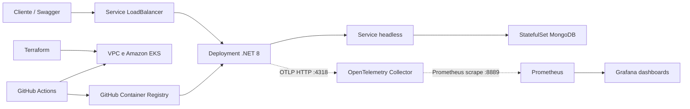

# PedeLogo Catálogo

[](https://dotnet.microsoft.com/)
[](https://aws.amazon.com/eks/)
[](https://www.terraform.io/)
[](https://www.mongodb.com/)
[](https://github.com/features/packages)
[](https://opentelemetry.io/)
[](https://prometheus.io/)
[](https://grafana.com/)

Projeto de referência para desenvolvimento e operação de uma API de catálogo de produtos com **.NET 8**, **MongoDB** e **Kubernetes na AWS (Amazon EKS)**. O repositório reúne a aplicação, infraestrutura como código, manifests Kubernetes, automação CI/CD e configuração de observabilidade.

> **Estado do projeto:** projeto de estudo e referência técnica. 

## Índice

- [Visão geral](#visão-geral)
- [Arquitetura](#arquitetura)
- [Tecnologias](#tecnologias)
- [Estrutura do repositório](#estrutura-do-repositório)
- [Executar localmente](#executar-localmente)
- [Testes](#testes)
- [Infraestrutura AWS com Terraform](#infraestrutura-aws-com-terraform)
- [Aplicação no Kubernetes](#aplicação-no-kubernetes)
- [Observabilidade](#observabilidade)
- [CI/CD](#cicd)
- [Segurança e operação](#segurança-e-operação)
- [Documentação relacionada](#documentação-relacionada)

## Visão geral

A API permite consultar, cadastrar, atualizar e remover produtos armazenados no MongoDB. O serviço é empacotado em uma imagem Docker e implantado no EKS. A infraestrutura AWS é descrita em Terraform, e os workflows do GitHub Actions automatizam verificações, build, publicação de imagem e implantação.

### Funcionalidades da API

| Método | Rota | Descrição |
|---|---|---|
| `GET` | `/Produto` | Lista os produtos |
| `GET` | `/Produto/{id}` | Consulta produto pelo identificador MongoDB |
| `POST` | `/Produto` | Cadastra um produto |
| `PUT` | `/Produto/{id}` | Atualiza um produto |
| `DELETE` | `/Produto?id={id}` | Remove produto pelo parâmetro `id` |
| `GET` | `/health` | Health check da aplicação |
| `GET` | `/read` | Readiness check usado pelo Kubernetes |
| `GET` | `/metrics` | Métricas expostas pelo `prometheus-net` |
| `GET` | `/swagger/index.html` | Interface Swagger/OpenAPI |

Consulte o Swagger do ambiente para ver o contrato publicado pela versão atualmente implantada.

## Arquitetura



### Fluxo de métricas

```text
API .NET 8
  -> instrumentação automática OpenTelemetry
  -> OTLP HTTP :4318
  -> OpenTelemetry Collector
  -> exporter Prometheus :8889
  -> ServiceMonitor
  -> Prometheus
  -> dashboard Grafana
```

## Tecnologias

| Área | Componentes usados |
|---|---|
| Aplicação | .NET 8, ASP.NET Core, MongoDB.Driver, `prometheus-net.AspNetCore` |
| Banco de dados | MongoDB 4.4.0 |
| Containers | Docker; imagens da API publicadas no GitHub Container Registry (GHCR) |
| Orquestração | Kubernetes no Amazon EKS; Deployments, StatefulSets, Services, HPAs, RBAC e NetworkPolicies |
| Infraestrutura | Terraform >= 1.7; AWS Provider `~> 6.67`; módulos AWS VPC 6.7.3 e EKS `~> 21.0` |
| Observabilidade | OpenTelemetry Operator e Collector Contrib 0.160.0, Prometheus, Grafana e `kube-prometheus-stack` chart 92.3.0 |
| CI/CD e qualidade | GitHub Actions, xUnit, SonarCloud, Trivy, Checkov |

As versões declaradas podem evoluir. Consulte os manifests, arquivos de projeto e workflows para a configuração efetivamente aplicada.

## Estrutura do repositório

```text
.
├── .github/
│   └── workflows/       # CI/CD da aplicação, Terraform e teste do cluster
├── infra/               # Terraform da VPC e do EKS; variáveis por ambiente
├── k8s/
│   ├── cadastro-k8s/    # API: Deployment, Service, HPA, RBAC e configuração
│   ├── mongodb-k8s/     # MongoDB: StatefulSet, Service, HPA e RBAC
│   └── README.md        # Guia de workloads Kubernetes
├── observability/       # OpenTelemetry, Prometheus, Grafana e script de tráfego
│   └── README.md        # Guia de implantação e diagnóstico da observabilidade
├── src/
│   ├── PedeLogo.Catalogo.Api/
│   ├── PedeLogo.Catalogo.sln
│   └── tests/
│       ├── PedeLogo.Catalogo.UnitTests/
│       └── PedeLogo.Catalogo.IntegrationTests/
├── testeEks/            # Manifest usado no teste de comunicação de pods
└── readme.md
```

## Executar localmente

### Pré-requisitos

- .NET SDK 8.x
- Docker, para executar MongoDB localmente
- Git

### 1. Iniciar o MongoDB local

Os valores abaixo são apenas para desenvolvimento local e correspondem aos defaults do `appsettings.json`. Não reutilize essas credenciais em ambientes compartilhados ou produção.

```bash
docker run --detach \
  --name catalogo-mongodb \
  --publish 27017:27017 \
  --env MONGO_INITDB_ROOT_USERNAME=mongouser \
  --env MONGO_INITDB_ROOT_PASSWORD=mongopwd \
  mongo:4.4.0
```

### 2. Restaurar dependências e iniciar a API

```bash
dotnet restore src/PedeLogo.Catalogo.sln
dotnet run --project src/PedeLogo.Catalogo.Api/PedeLogo.Catalogo.Api.csproj
```

O perfil do projeto declara `http://localhost:5000` e `https://localhost:5001`. Abra o Swagger em <http://localhost:5000/swagger/index.html>.

Para encerrar e remover o container local do banco:

```bash
docker stop catalogo-mongodb
docker rm catalogo-mongodb
```

## Testes

Executar os projetos de teste individualmente:

```bash
dotnet test src/tests/PedeLogo.Catalogo.UnitTests/PedeLogo.Catalogo.UnitTests.csproj
dotnet test src/tests/PedeLogo.Catalogo.IntegrationTests/PedeLogo.Catalogo.IntegrationTests.csproj
```

Os testes de integração dependem de uma instância MongoDB disponível. A pipeline de integração configura MongoDB 4.4.0 como serviço e fornece as credenciais por GitHub Secrets.

Executar todos os testes da solução:

```bash
dotnet test src/PedeLogo.Catalogo.sln
```

## Infraestrutura AWS com Terraform

O código em [`infra/`](./infra/) provisiona uma VPC e um cluster Amazon EKS usando os módulos comunitários da AWS:

- VPC com subnets públicas e privadas, NAT Gateway e VPN Gateway.
- EKS com endpoints público e privado habilitados.
- Managed Node Group com tamanho mínimo 2, desejado 2 e máximo 4 nós.
- Add-ons CoreDNS, kube-proxy, VPC CNI e EKS Pod Identity Agent.
- Kubernetes configurado nos arquivos de ambiente com versão `1.35`.

Os valores de ambientes estão em `infra/staging.tfvars` e `infra/prod.tfvars`; bucket, chave e credenciais do backend remoto são fornecidos pela configuração dos workflows. Não inclua credenciais ou valores sensíveis em commits.

Os comandos locais de validação, dentro de `infra/`, são:

```bash
terraform init -backend=false
terraform fmt -check
terraform validate
```

Para criar ou modificar infraestrutura, confira o ambiente/contexto, backend e plano antes de executar `terraform apply`. A automação usa os ambientes e permissões configurados no GitHub Actions.

## Aplicação no Kubernetes

A API e o MongoDB são implantados no namespace `default`. A API fica disponível por um Service `LoadBalancer` na porta 80; o MongoDB é acessível internamente por um Service headless na porta 27017.

O manifesto da API contém `IMAGE_TAG` como placeholder. Para deployment manual, use uma tag já publicada no GHCR e verifique o Secret de pull `ghcr-secret`; a pipeline injeta a imagem construída para o commit. O MongoDB usa StatefulSet, probes de saúde, recursos requests/limits e políticas de rede.

Guia de pré-requisitos, implantação, configuração, autoscaling e diagnóstico: [`k8s/README.md`](./k8s/README.md).

## Observabilidade

A configuração em [`observability/`](./observability/) instrumenta a API com OpenTelemetry, exporta métricas para Prometheus e disponibiliza um dashboard Grafana. O dashboard apresenta taxa de requisições, latência, respostas 5xx e métricas por rota.

Guia completo de implantação do stack, instrumentação, acesso por port-forward, geração de tráfego e troubleshooting: [`observability/README.md`](./observability/README.md).

## CI/CD

Os workflows ficam em `.github/workflows/`. O comportamento abaixo resume os gatilhos definidos nos arquivos atuais:

| Fluxo | Gatilho/escopo | Etapas principais |
|---|---|---|
| Testes da aplicação (`App_testeEstatico.yaml`) | Push para `feature/**`, `hotfix/**` ou `main`, e PR para `main`; alterações em `src/**` | Testes unitários, integração com MongoDB, cobertura e análise SonarCloud |
| Build de imagem (`App_CI.yaml`) | Reutilizável; chamado pelo workflow de testes em PR após os jobs de qualidade | Build Docker, scan Trivy para vulnerabilidades CRITICAL e push ao GHCR com tags do commit e `latest` |
| CD da aplicação (`App_CD.yaml`, `App_CD_prod.yaml`) | Workflows reutilizáveis chamados pelo fluxo da aplicação | Deploy dos manifests no EKS com a imagem do commit; configurações usam GitHub Environments `staging` e `production` |
| Validação Terraform (`infra_teste_Statico.yaml`) | Push para `feature/**` ou `hotfix/**`; alterações em `infra/**` | `terraform init -backend=false`, validate, fmt e Checkov (configurado como soft-fail) |
| Plan e deploy staging (`infra_CI.yaml`, `infra_CD.yaml`) | PR para `main`; alterações em `infra/**` | Gera plano, aplica o artefato em staging e executa teste de cluster |
| Plan e deploy production (`infra_CI_Prod.yaml`, `infra_CD_Prod.yaml`) | Push para `main`; alterações em `infra/**` | Gera plano e executa apply em production |

> Revise os gatilhos dos workflows e as proteções dos GitHub Environments antes de adotar a pipeline em produção. A aprovação manual depende da configuração dos environments no GitHub; ela não é garantida apenas pelo nome do ambiente no YAML.

### Configuração necessária no GitHub

Os workflows dependem de configurações em **Settings → Secrets and variables → Actions** e de environments `staging` e `production`. Entre os nomes referenciados pelos workflows estão:

- Secrets: `AWS_ROLE`, `BUCKET`, `KEY`, `TF_VARS`, `mongo_user`, `mongo_pwd`, `SONAR_PROJECT_KEY`, `SONAR_ORGANIZATION`, `SONAR_TOKEN`.
- Variables: `REGION`, `CLUSTER_NAME`, `TF_VERSION`.

Configure as credenciais AWS via OIDC conforme os workflows e limite permissões às funções necessárias. Os valores reais devem ser definidos no GitHub, nunca copiados para documentação ou commits.

## Segurança e operação

- Os valores Base64 de Kubernetes Secrets **não são criptografia**. Os Secrets de exemplo nos manifests não devem ser tratados como credenciais seguras; substitua-os e rotacione qualquer credencial que tenha sido usada em um cluster compartilhado.
- Prefira AWS Secrets Manager/External Secrets ou geração de Secrets fora do repositório para ambientes reais.
- Revise exposição do LoadBalancer, autenticação/autorização da API, NetworkPolicies e regras de Security Groups antes de produção.
- O `kube-prometheus-stack` está configurado com retenção Prometheus de 1 dia e armazenamento efêmero (`emptyDir`); métricas podem ser perdidas quando o pod reinicia.
- Configure backup e persistência apropriados para dados MongoDB antes de uso produtivo.
- Proteja o acesso aos dashboards e ao endpoint Prometheus. O port-forward é recomendado para acesso local de operação.

## Documentação relacionada

- [Kubernetes: arquitetura, deploy e troubleshooting](./k8s/README.md)
- [Observabilidade: OpenTelemetry, Prometheus e Grafana](./observability/README.md)
- [Workflows de CI/CD](./.github/workflows/)
- [Infraestrutura Terraform](./infra/)

## Autor

**Patrick Amorim** — [@patrickpk4](https://github.com/patrickpk4)

Projeto de estudo e referência técnica para desenvolvimento, infraestrutura e operação cloud-native.
